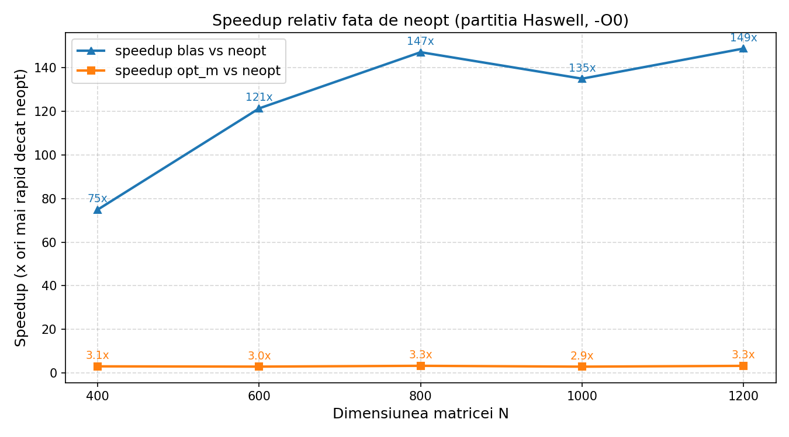
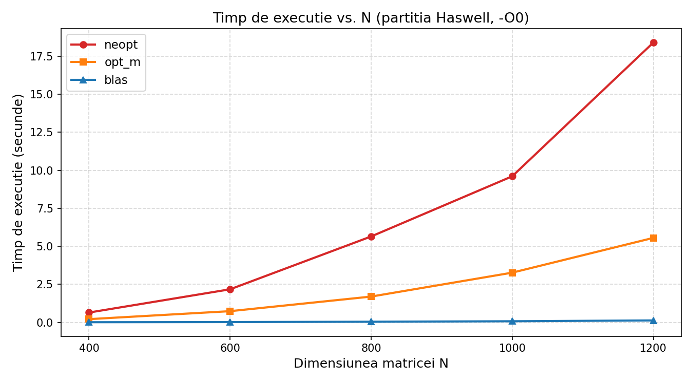
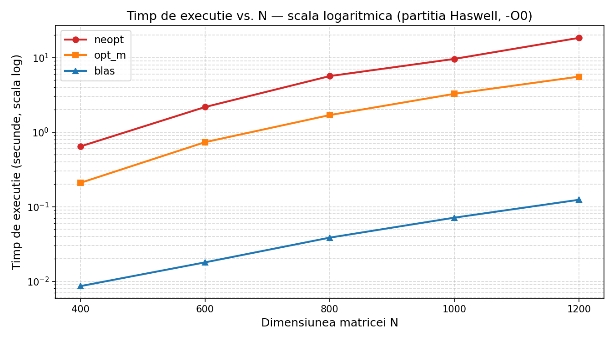
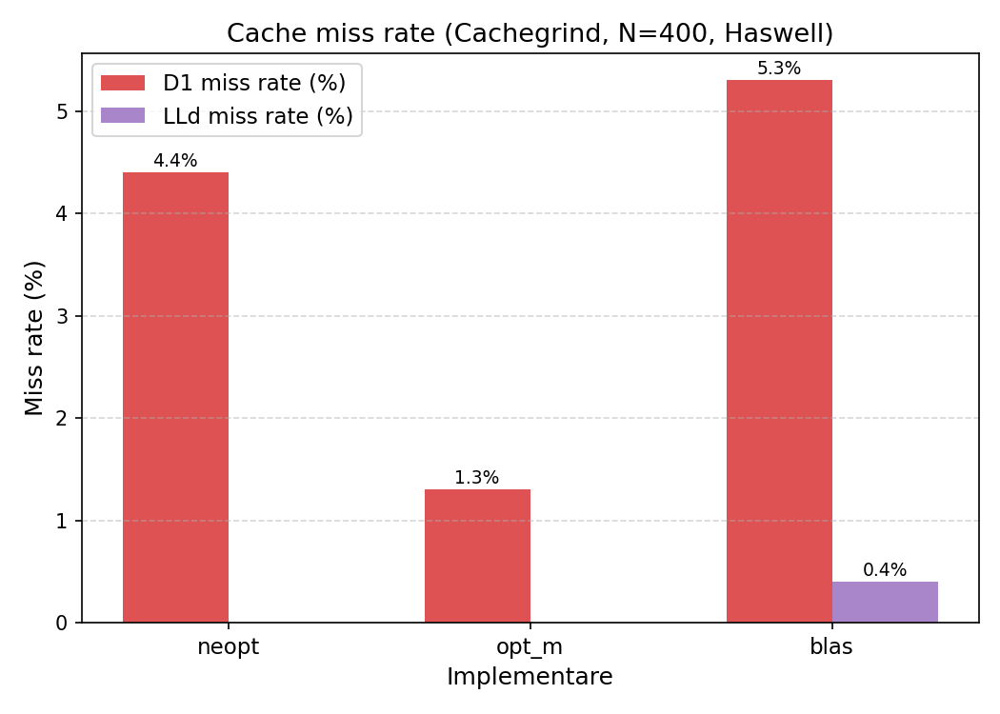

# Matrix Multiplication Optimization in C

Three implementations of the same dense linear-algebra kernel, compared on an Intel Haswell server:

| Version | Approach | Speedup vs. naive (N = 400 … 1200) |
|---------|----------|-------------------------------------|
| `neopt` | Straightforward triple loops | 1x |
| `opt_m` | Hand-optimized C: loop reordering, pointer arithmetic, unrolling, symmetry | **3.1x – 3.3x** |
| `blas`  | OpenBLAS (`dgemm`, `dsyrk`, `dgemv`, `dsymv`, `daxpy`) | **75x – 149x** |

All code is compiled with **`-O0`**, so every speedup in `opt_m` comes from the source code itself, not from the compiler.



## The problem

Given `N x N` matrices `A`, `B` and a vector `x`, compute:

```
C = Aᵀ · B
D = C · Cᵀ
y = Σᵢ D · rowᵢ(C) + x
```

## Implementations

### `neopt`: baseline (`src/solver_neopt.c`)
- `C = AᵀB` in `ijk` order. `A[k*N + i]` is read column-wise with stride `N`, which causes frequent cache misses.
- `D = CCᵀ` computes only the upper triangle and mirrors it, giving about N³/2 operations.
- `y` is computed as N matrix-vector products, which costs O(N³).

### `opt_m`: hand-tuned (`src/solver_opt.c`)
- **Loop reordering (`kij`)** for `C = AᵀB`. `A[k][i]` is loaded once into a register, and the inner loop streams sequentially through the rows of `B` and `C`.
- **Pointer arithmetic** instead of `arr[i*N + j]` removes integer multiplications from the inner loops.
- **Register blocking for `D = CCᵀ`.** 8 output elements are computed at once with 8 accumulators, and `k` is unrolled by 4. That gives 32 FMAs per iteration from a single set of loads from `C[i]`. Remainder loops handle 4 columns and then single columns.
- **Symmetry in the `y` step.** Each `D[j][k]` with `k > j` contributes to both `y[j]` and `y[k]` in one pass, which halves the multiply-adds.
- **Loop unrolling** (x8 / x4) reduces branch overhead by about 10x.

### `blas`: OpenBLAS (`src/solver_blas.c`)
- `cblas_dgemm` computes `AᵀB` with the transpose handled internally (no cache penalty).
- `cblas_dsyrk` computes `CCᵀ` and writes only the upper triangle.
- **Algebraic reformulation:** `Σᵢ D·rowᵢ(C) = D · (Cᵀ · 1)`. This turns the last step from O(N³) into two O(N²) calls: `dgemv` for the column sums, then `dsymv`.
- `cblas_daxpy` computes the final `y += x`.

## Results

**Test system:** Intel Xeon E5-2640 v3 @ 2.60 GHz (Haswell, 8 cores), L1d 32 KB, L2 256 KB, L3 20 MB, GCC 14.3.1, `-O0 -march=native`.

### Execution time (seconds)

|   N  |  neopt  |  opt_m |   blas   |
|------|---------|--------|----------|
|  400 |  0.644  | 0.209  | 0.00860  |
|  600 |  2.173  | 0.734  | 0.01792  |
|  800 |  5.649  | 1.694  | 0.03843  |
| 1000 |  9.606  | 3.267  | 0.07123  |
| 1200 | 18.399  | 5.554  | 0.12376  |

<p>
  
  
</p>

### Cache behaviour (Cachegrind, N = 400)

| Version | Instr. (M) | Data refs (M) | D1 miss | LLd miss | Branches (M) | Mispredict |
|---------|-----------:|--------------:|--------:|---------:|-------------:|-----------:|
| neopt   | 5,850      | 3,184         | 4.4%    | 0.0%     | 161.9        | 0.3%       |
| opt_m   | 2,127      | 1,241         | **1.3%**| 0.0%     | 15.5         | 3.0%       |
| blas    | 84         | 32            | 5.3%    | 0.4%     | 4.3          | 2.1%       |

- `opt_m` executes 2.75x fewer instructions and has a 3.4x lower D1 miss rate than `neopt`.
- BLAS has a higher *rate* of misses but about 100x fewer total data accesses.
- At N = 400 all matrices fit in L3, so there is no pressure on main memory.



Valgrind Memcheck reports **0 errors and no leaks** for all three versions (see `results/memcheck/`).

## Build & run

Requires GCC and OpenBLAS (`libopenblas-dev`).

```bash
cd src
make
./tema1_neopt ../input/input      # also: tema1_opt_m, tema1_blas
./compare out1 ../references/out1 0.001
```

`input/input` lists the test cases (`N seed output_file`). The reference outputs are in `references/`. Correctness was validated against them on the course's Haswell cluster; on other machines, results may differ slightly from the references.

To profile:

```bash
valgrind --tool=cachegrind ./tema1_opt_m ../input/input_valgrind
valgrind --tool=memcheck --leak-check=full ./tema1_opt_m ../input/input_valgrind
```

To regenerate the plots: `cd plots && python3 gen_graphs.py` (requires matplotlib).

## Repository layout

```
src/            solvers + test harness
input/          test case definitions
references/     reference outputs for correctness checks
results/        raw Cachegrind and Memcheck logs
plots/          graphs + generation script
```

## Credits

Developed as an assignment for the *Computer Systems Architecture* course at the Faculty of Automatic Control and Computers, Politehnica University of Bucharest (2026). The test harness (`main.c`, `utils.h`, `compare.c`, `Makefile`) was provided by the course team. The solvers, analysis and plots are my own work.
